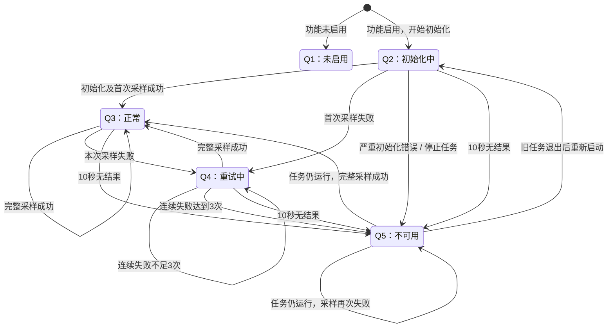

# 电源状态接口速查

入口：`firmware/main/app/power_state.h` 的 `power_state_get_snapshot()`；对应 #59 的接口部分。

## 状态转换

## 状态含义

| 状态 | 含义 | 数据使用 |
| --- | --- | --- |
| Q1 未启用 | 未启动采集 | 无数据 |
| Q2 初始化中 | 等待首次完整结果 | 无有效数据 |
| Q3 正常 | 最近一轮完整读取成功 | 当前有效；芯片故障需独立判读 |
| Q4 重试中 | 连续失败 1～2 次，继续采样 | 有历史值时标为旧数据 |
| Q5 不可用 | 连续失败 3 次、10 秒无结果或严重错误 | 历史值仅供诊断；严重错误停止任务 |

## 快照使用

- 返回 `ESP_OK` 表示获取快照成功；设备错误看 `last_error` 和 `reason`。
- 使用当前测量前检查 `current_valid`；`has_data` 表示存在完整历史值，`is_stale` 标识旧值。
- `data` 包含身份、供电/充电编码、历史/当前故障及 VBUS/SYS 毫伏值；`voltage_available=false` 时不能把电压字段的 0 当作测量。
- `last_attempt_us`、`last_result_us`、`last_success_us` 分别为尝试、结果、成功的启动后单调微秒；首次结果前，`last_result_us` 为初始化起点。
- ADC 开启时，基础状态、电压及转换收尾全部成功才发布；失败保留整份旧数据，成功清零失败计数并恢复 Q3。
- 单一采集任务发布，多任务可读取独立副本；短临界区保护，查询只检查超时和复制快照，不访问 I²C，不支持 ISR。
- Q5→Q2 仅允许旧任务完全退出后重新启动；不能仅凭 `task_running=false` 并发创建新任务。
