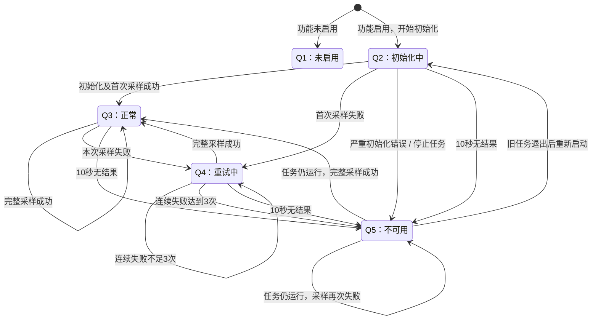

# 基础电源状态接口

对应 #59 的数据接口部分，尚未接入 LVGL。现有电源任务是唯一采集者，日志与后续界面通过
`firmware/main/app/power_state.h` 获取一致性快照，查询不会访问芯片。

## 状态转移图



## 状态职责

| 编号 | 状态 | 行为 | 对外数据 |
| --- | --- | --- | --- |
| Q1 | 未启用 | 不启动采集、不访问设备 | 无有效数据 |
| Q2 | 初始化中 | 初始化、执行现有校验，等待首次结果 | 无有效测量 |
| Q3 | 正常 | 更新完整结果，连续失败计数清零 | 当前有效数据与成功时间 |
| Q4 | 重试中 | 每次失败记录并计数，维持原间隔重试 | 最近完整成功的旧数据；若从未成功则无数据 |
| Q5 | 不可用 | 记录原因，普通失败继续重试；严重初始化错误停止任务 | 历史数据仅供诊断，不作为当前有效测量 |

Q3 只表示完整数据可用；芯片报告的故障仍独立提供，不代表电源完全健康。
不根据充电状态编码推断电池存在、真实充满或电量百分比。

## 采样与失败规则

- ADC 启用时，基础状态与 ADC 均成功才发布本轮完整结果；任一失败，每轮仅累计一次。
- ADC 关闭时，只要求基础状态成功；`voltage_available=false`，电压为 0，不能解读为实际 0V。
- 第 1、2 次连续失败进入 Q4，第 3 次进入 Q5。旧成功快照整体保留，绝不混入本轮部分成功数据。
- Q5 锁存到完整成功或重新启动；即使更新超时后新的失败结果到达，也不回退为 Q4。
- 达到 10,000,000 微秒没有结果时进入 Q5，原因为 `UPDATE_TIMEOUT`；尝试开始时间不延后超时。
  超时在查询、开始尝试或发布结果时检查，不新建监视任务，不触发 I²C、寄存器写入或硬件复位。
- 普通通信错误沿用现有间隔重试。型号不符、任务创建失败，以及看门狗/ADC 初始化校验失败，
  立即 Q5 并标记任务停止；不扩大当前硬件恢复范围。
- 不新增手动重启入口。Q5 → Q2 的内部生命周期入口只允许在旧任务完全退出后使用，
  当前由启动流程调用；不能仅看到 `task_running=false` 就并发启动新任务。

## 快照读取

```c
power_state_snapshot_t power;
if (power_state_get_snapshot(&power) == ESP_OK) {
    if (power.current_valid) {
        // 使用 power.data；仍需独立判读 fault_current_raw。
    } else if (power.state == POWER_STATE_Q4_RETRYING && power.has_data) {
        // 可显示 power.data，但必须标为旧数据、重试中，并关联 last_success_us。
    } else {
        // 显示初始化、未启用或不可用原因；不能把历史值当作当前值。
    }
}
```

- 返回 `ESP_OK` 只代表成功获取快照，设备错误在 `last_error`、`reason` 中表达；NULL 参数返回错误。
- `has_data` 表示存在完整历史结果；只有 `current_valid=true` 可作为当前有效数据。
  Q4/Q5 若存在旧值，`is_stale=true`；没有历史值时不得用零值代替测量。
- 时间是本次启动后的单调微秒，重启后重新计时。`last_attempt_us` 是最近尝试开始时间，
  `last_result_us` 是最近返回结果的时间（初始化时先设为开始时间），`last_success_us` 是完整成功发布时间。
- `consecutive_failures` 每轮最多加一，成功清零，达到 UINT32_MAX 后饱和；超时和停止不伪造采样失败次数。
- `data` 包含身份、输入源、PG/VSYSMIN、充电编码、历史/当前故障原始值与 VBUS/SYS。
  历史故障是最后完整成功轮次读取的历史信息，不承诺累计保存所有失败轮次消费的 REG0C 锁存故障。
- 多任务可并发读取自有副本；内部通过短临界区保护状态和数据的一致性，不跨临界区执行 I²C、等待或日志。
  不支持 ISR 调用，也不向界面暴露 I²C 句柄。查询可能锁存超时状态，但不改变硬件。

## 启动和日志

基础电源测试关闭时，模块保持 Q1。启用时，`app_main` 在创建任务前预留唯一采集者、发布 Q2；
任务创建失败发布 Q5。原采集间隔、连续转换窗口、调试关闭看门狗和启动恢复逻辑保持原样。
日志中的 `state=Q*`、`current_valid`、`stale`、`consecutive_failed` 与电压来自同一快照；
驱动原始诊断仍保留，失败轮次日志不作为有效测量。上层接口不额外读取 REG0C。

## 软件验证

运行 `bash firmware/tests/power_state/run.sh`，使用主机 C11 编译器和 pthread，不连接硬件：

- 覆盖 Q1/Q2/Q3/Q4/Q5、连续失败阈值、失败后恢复、首次失败无历史数据。
- 覆盖 Q2/Q3/Q4 的超时边界、尝试不延后超时、迟到失败不解除 Q5。
- 覆盖严重错误停止、停止后迟到结果被忽略、重新启动、ADC 关闭和快照副本独立性。
- 一写两读线程验证 20,000 次发布与 60,000 次读取的一致性。测试仅链接状态模块和锁/时钟替身，
  不链接 I²C；这验证主机模型中的并发行为，不代替 ESP32 双核实板验证。

实板供电与 ADC 历史结果见 [供电验证记录](power-basic-validation.md)。历史 10 分钟结果对应接口改造前版本，
不能作为本状态机的实板验证。软件验证阶段未烧录；后续实板冒烟结果见下节。

### 2026-11-08 实际验证结果

受测源码：`d48820b` 加本次未提交的状态接口改动。以下为软件检查，未访问硬件，不更新 Issue 完成状态。

| 检查 | 结果 |
| --- | --- |
| `bash firmware/tests/power_state/run.sh` | 退出 0；状态转换、阈值、超时锁存、历史值、停止/重启、ADC 关闭和并发快照检查通过 |
| 电源测试关闭构建 | ESP-IDF v6.1 / ESP32-S3，退出 0 |
| 仅基础状态构建 | ESP-IDF v6.1 / ESP32-S3，退出 0 |
| 基础状态加 ADC 构建 | 原配置主工程构建，退出 0，生成 `firmware/build/BYAI.bin`、`.elf` |
| `git diff --check` | 通过 |

三种配置均沿用同一 EIM SDK/Python；原 `firmware/sdkconfig` 和依赖锁文件没有改动。
主工程 ADC 镜像 SHA256：`b76f3075199995ffcc0a5490bed988d2d17fd80b97aee9314da3f70b83fd77d4`。
ADC 构建日志为 `/tmp/byai-power-state-build-adc.log`；关闭/基础配置使用临时配置和共享临时构建目录，
日志位于 `/tmp/byai-power-state-matrix-eqbjx1vt/build-disabled.log`、`build-basic.log`。
该临时构建目录最终保留的是仅基础状态产物，关闭配置的构建成功以对应日志为证。

上述软件检查不等于实板通过；未专项验证任务栈余量、实际双核时序或异常硬件输入。后续正常路径冒烟记录如下。


### 2026-11-08 实板正常路径冒烟测试

用户确认已接入并要求开始简单测试；沿用 20261001 板、USB 供电、无电池、接屏的测试条件，
未要求操作者拔线、改接线或重新测量电压。使用稳定 USB JTAG/serial 设备
`B8:1F:3F:A4:B1:88`（本机 ttyACM0），配置为 ESP32-S3，基础状态、ADC、
调试关闭看门狗和彩条选项均启用。未修改任何充电参数或看门狗策略。

- 从 ENV.local 激活同一 EIM SDK/Python，进入 firmware 执行 `idf.py build`、`idf.py -p PORT flash`。
  两者退出 0，写入数据哈希校验通过，未擦除 NVS。随后用 SDK Python/PySerial 以 115200 波特率采集。
- 源码基线为 `d48820b` 加本次状态接口未提交修改；设备版本字符串为 d48820b-dirty。
  镜像 SHA256：`b76f3075199995ffcc0a5490bed988d2d17fd80b97aee9314da3f70b83fd77d4`。
- 采集从北京时间 2026-11-08 16:51:39 开始，持续 120.3 秒，进程退出 0。

| 检查 | 结果 |
| --- | --- |
| 状态转换 | 记录 Q2 一次，随后 51 次 Q3；未出现 Q4/Q5 |
| 数据有效性 | 51 次均为 current_valid=1、stale=0、consecutive_failed=0、error=ESP_OK |
| 转换收尾 | 51 次完整结果均匹配 CONV_RATE=0 且 ESP_OK 的回读 |
| 电压日志 | VBUS 5100mV、SYS 4164mV；本轮没有重新做万用表对照 |
| 单调时间 | 所有 Q3 的尝试及成功时间持续增长，result_us=success_us，且不早于 attempt_us |
| 显示 | 14 次彩条心跳；用户确认“彩条正常，无异常发热” |
| 内存 | 日志中 PSRAM 空闲为 8,385,016 字节，未观察到变化；未测任务栈余量 |
| 重启/异常 | 打开串口时 1 次 USB_UART_CHIP_RESET；之后未观察到重启或 panic |
| 芯片状态 | PG=1，当前故障原始值 0x03；不把“Q3”解释为芯片所有状态均正常 |
| 会话 | 采集退出 0，finally 关闭串口；fuser 确认无占用。板上采集任务仍运行 |

日志仍包含既有的 `E TAG: 2 ESP_OK`（SPI 成功结果用错误级别打印），不作为本轮功能失败。
只统计捕获到完整结果的 51 轮；关闭主机串口不代表板上任务停止，也不保证此刻芯片没有处于下一轮转换。

证据目录 `/tmp/byai-power-state-smoke-20261108/` 保存 `build.log`、`flash.log`、`serial.log`、
`status.json`、`summary.json` 和 `manifest.json`；manifest 记录受测源码、配置及镜像哈希。

结论：本次正常启动、Q2→Q3、持续采样与彩条并行的简单冒烟检查通过。
本次冒烟未主动触发 Q4/Q5、超时、三次失败或严重初始化错误；截至该次冒烟，这些场景仅有主机模型测试。
后续 ESP32 软件注入结果见下节，不等同真实 I²C 故障验证。未提交、推送或更新远端 Issue/PR。


## 可关闭的 ESP32 软件故障注入

`CONFIG_BYAI_POWER_STATE_FAULT_TEST` 默认关闭，依赖基础电源测试。仅诊断时在 menuconfig 中开启
“Diagnostic only: inject power state failures instead of sampling”。此模式用一次性诊断任务替代正常电源采集任务，
日志带 `synthetic=1`，不注册或访问 BQ I²C 设备、不修改芯片寄存器；合成电压是测试标记值，不能当作实测。
外部芯片原有状态不会由注入套件清除，结束后须关闭开关并烧录正常版本恢复采集。

套件自动执行两次失败恢复、三次失败及后续恢复、真实 10 秒无更新、严重初始化错误四个软件场景。
超时用例由暂停发布的生产者任务和独立查询快照的观察者任务配合；观察者不写测量结果或访问硬件。
严重初始化错误仅模拟错误结果和生命周期，不执行真正的硬件初始化失败或资源故障。

检查日志每步 `result=PASS` 以及最终 `SUITE result=PASS`；任何失败停止套件并保留日志。
套件结束后诊断任务自行退出，正常采集不会自动启动。恢复正常固件后需确认注入开关关闭、
Q2→Q3、有效性标志、实际电压日志及无注入标记。

### 2026-11-08 ESP32 注入结果

用户要求尝试软件注入，沿用 20261001 板 USB 连接、无电池、接屏条件，未要求插拔或改接线。
ESP-IDF v6.1 / ESP32-S3，诊断配置位于测试机临时目录，未把启用注入的配置写入仓库配置。
诊断及正常恢复版本均构建退出 0，烧录退出 0、写入数据哈希校验通过；未执行 NVS 擦除。

| 场景 | 捕获的行为 | 结果 |
| --- | --- | --- |
| 两次失败恢复 | Q3→Q4(1)→Q4(2)→Q3，保留完整旧值及成功时间；恢复后更新时间并清零计数 | PASS |
| 三次失败与恢复 | Q3→Q4(1)→Q4(2)→Q5(3)→Q5(4)→Q3，后续失败不解除 Q5，恢复后有效性正常 | PASS |
| 更新超时 | 生产者暂停，core 0 独立观察者在无结果 10,005,002 微秒时读到 Q5/UPDATE_TIMEOUT；随后失败仍 Q5，再成功恢复 Q3 | PASS |
| 严重初始化错误 | 重新开始软件测试生命周期后 Q2→Q5/STARTUP_ERROR，running=0；迟到成功结果被忽略，不产生虚假有效数据 | PASS |

采集从北京时间 2026-11-08 17:00:31 开始，12.5 秒捕获最终 `SUITE result=PASS`，采集退出 0 并关闭串口。
注入期间未启动 `power_test` 正常采集任务，日志没有实际 BQ 读取；不把合成样本当作芯片状态。
打开串口时 1 次 USB_UART_CHIP_RESET，随后未捕获 panic。显示任务继续运行，但本轮未再次向操作者确认视觉效果。

- 注入镜像 SHA256：`0ce2b1a70f59b990bcb778dd93c077a1d30a79bfd5e763d7a4ffa09dda6e4cef`。
- 正常恢复镜像 SHA256：`08c1de7cb30694c9af84e40b3214a85a4fcba00a1e114f6758fceda3f9a5c335`。
- 本机证据目录 `/tmp/byai-power-state-injection-20261108/`：`build.log`、`flash.log`、
  `inject-serial.log`、`inject-status.json`、`summary.json`、`normal-build.log`、`restore-flash.log`。
- 主机 `bash firmware/tests/power_state/run.sh` 仍通过。正常配置保留原采样/看门狗选项，新增注入选项为关闭。

这些结果验证状态机在真实 ESP32 的时钟和任务环境中的软件异常转换，不代替真实 I²C 断线、
芯片损坏、初始化寄存器校验失败或充电安全验证。

恢复确认：关闭注入的主工程版本重新烧录并校验成功后，采集 30.1 秒，捕获 Q2→Q3、
12 次完整采样及 12 次停止转换成功回读，均 current_valid=1、stale=0、连续失败为 0。
VBUS=5100mV、SYS=4164mV；没有合成测试标记。正常镜像也不包含诊断套件提示字符串。
打开串口时 1 次 USB_UART_CHIP_RESET，随后未捕获 panic；恢复采集退出 0 并关闭串口，fuser 无占用。
证据为同目录 `normal-serial.log`、`normal-status.json`、`normal-summary.json`。
当前板上运行正常采集固件，原先的调试关闭看门狗策略保持不变，代码和记录尚未提交。
